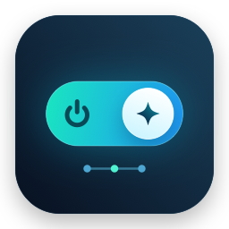

# AI 连接开关 · AI Connection Switch



让 Claude 桌面、Claude Code 和 Codex 在 macOS 上使用独立代理。遇到连接问题时，可在桌面开关里切回 Shadowrocket。你需要自备 VLESS Reality 服务器。

[English overview](README.en.md) · [MIT License](LICENSE)

| 模式 | AI 应用的连接路径 |
| --- | --- |
| 独立连接 | 本机 HTTP 代理 → 当前联网网卡 → 自建 VPS |
| 通过 Shadowrocket | 本机 HTTP 代理 → Shadowrocket 的 HTTP 端口 |
| 紧急恢复 | 应用重开后直接通过 Shadowrocket，适用于独立代理服务不可用时 |

开关只配置这些 AI 应用的代理，不控制 macOS 的 VPN、全局代理或 DNS。切换会中断已有的代理请求，建议在任务空闲时操作。

## 安装

需 macOS 13+、[Apple Command Line Tools](https://developer.apple.com/documentation/xcode/installing-the-command-line-tools)（含 Python 3.9+ 和 Swift），以及支持 Reality、uTLS 和 Clash API 的 sing-box。已有可执行文件可直接复用，或按 [sing-box 官方说明](https://sing-box.sagernet.org/installation/package-manager/) 用 `brew install sing-box` 安装。本项目在本机编译桌面应用并为当前用户启动后台代理。

1. 用 `/usr/sbin/networksetup -listallhardwareports` 找到正在联网的 Wi-Fi 或有线网卡，确认它有 IPv4 地址（例如 `/usr/sbin/ipconfig getifaddr en0`）。如果要使用 Shadowrocket 回退，核对它的本机 **HTTP** 代理端口，默认示例为 `1082`。
2. 在 macOS Terminal 中运行以下命令，把 `en0` 和端口换成你的值。sing-box 不在 PATH 时，追加 `--sing-box /实际路径/sing-box`。

   ```sh
   git clone https://github.com/leeli777/ai-connection-switch.git
   cd ai-connection-switch
   /usr/bin/python3 install.py --interface en0 --shadowrocket-port 1082
   ```

3. 按终端提示粘贴你自己的 **IPv4 VLESS + Reality + Vision/TCP** 分享链接。输入会隐藏。也可用 `--link-file` 指向仓库外仅自己可读写的文件。安装器会预检 Claude 和 OpenAI 的连通性。通过后，桌面会出现 **AI 连接开关**。
4. 打开开关，点 **接入 AI 应用**。等任务空闲后，在开关里分别重开 Claude 和 Codex。Claude 桌面完全退出后，建议继续从开关启动，确保应用收到代理参数。单独运行的 Claude Code 会话请在空闲时自行退出，再启动新会话。
5. 在每个实际使用的应用里发一条消息，再点 **刷新状态**。拿到实际回复并观察到应用经本机 `1086` 建连后，即可确认接入。**检查连接**只探测未登录的 API，可达时预期返回 HTTP 401。

安装时会检查本机端口（`1086`、`1087`、`19090`）及同名文件。若已被占用，先核对归属。开关识别 `/Applications` 下的官方 Claude.app，以及带 Codex bundle ID 的 Codex.app 或 ChatGPT.app。其他安装路径、单独的浏览器和外部工具需自行确认代理。

## 回退与卸载

Shadowrocket 可用时，可直接在开关里切回。独立代理服务失效时，先确认 Shadowrocket 自身连通，再点 **紧急恢复 Shadowrocket** 并逐个重开 AI 应用。

要恢复接入前的代理设置，在终端运行：

```sh
helper="$HOME/Library/Application Support/AIConnectionSwitch/ai_switch_control.py"
/usr/bin/python3 "$helper" restore
```

恢复只还原本工具管理的 Claude/Codex 代理键。若检测到这些键被外部修改，会要求手动核对。恢复后，按原来的方式重新打开 AI 应用。

卸载前先恢复设置、确认应用已通过原来的方式连通，再用 `launchctl bootout "gui/$(id -u)/local.ai-connection-switch"` 停止本项目的后台服务。可移除本项目创建的以下文件：

- `~/Library/LaunchAgents/local.ai-connection-switch.plist`
- `~/Desktop/AI 连接开关.app`（快捷方式）
- `~/Applications/AI 连接开关.app`
- `~/Library/Application Support/AIConnectionSwitch`（包含节点凭据和代理设置备份）

代理和控制端口只监听 `127.0.0.1`。如需提交 Issue，请提供 macOS、应用和 sing-box 版本，并去除节点链接、密钥、账号和私有配置。测试方法见 [验证记录](VALIDATION.md)。
